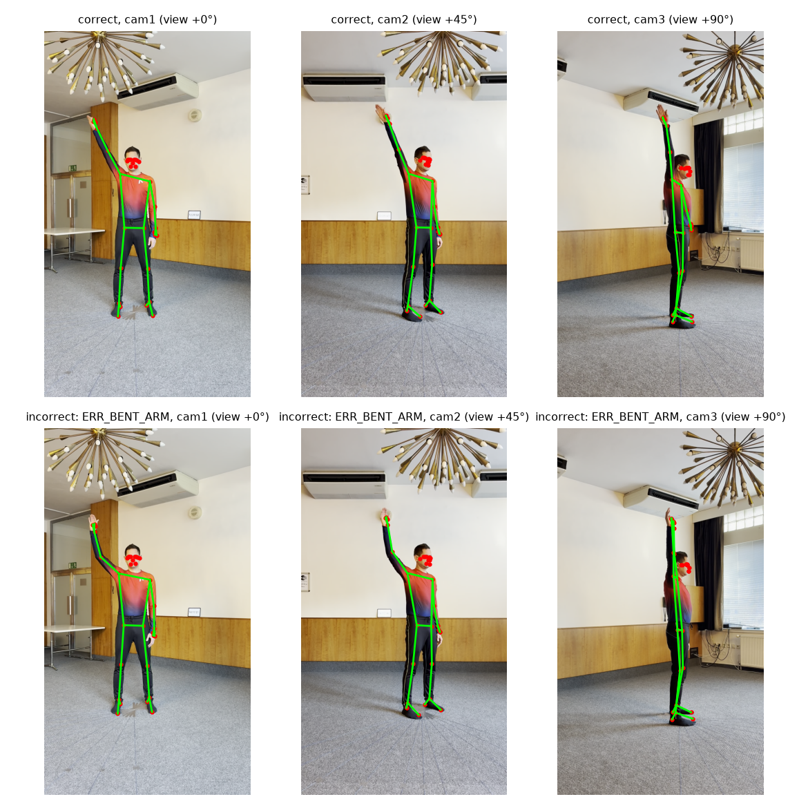
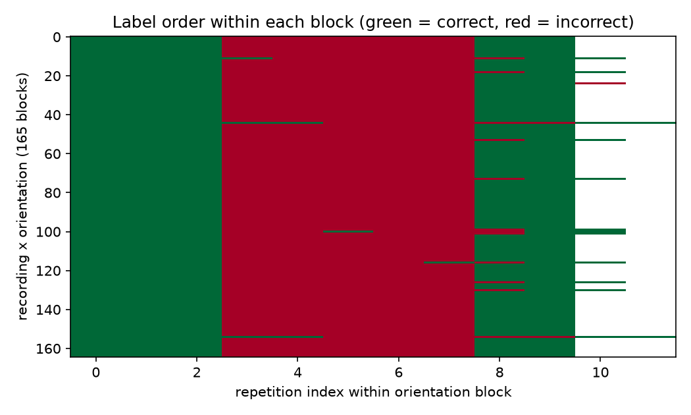
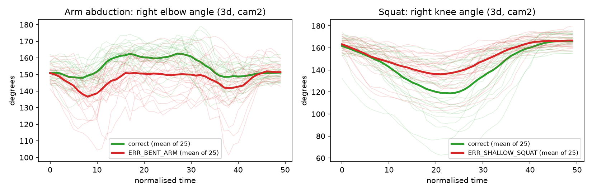

# Evaluating Biomechanical and Temporal Movement Representations for Rehabilitation Exercise Assessment

Jake Van Slyke
University of Oklahoma Polytechnic Institute
AAI 5303: Deep Learning I
October 22, 2026

## 1. Problem and Research Question

Physical rehabilitation depends on repeating exercises with proper form, but assessing form consistently outside a clinic is hard. Video-based models could help, although camera angle and imperfect pose estimation make the problem harder than it looks.

I'm also interested in how similar methods could eventually apply to sports biomechanics, such as basketball shooting mechanics or snowboarding movements. Rehabilitation is a more controlled starting point because it comes with labeled examples of correct and incorrect movement.

**Research question:** How do biomechanical features and temporal modeling affect the accuracy and viewpoint robustness of rehabilitation exercise classification? Specifically, do joint angles and movement patterns improve on raw skeletal coordinates, and do they generalize better to camera views not seen during training?

My expectation is that joint angles will hold up better on unseen camera views than raw coordinates, since they are closer to what a clinician actually judges and don't depend much on where the camera sits. If normalized coordinates turn out just as robust, that is still a useful answer.

The **input** is the pose sequence of one exercise repetition from one camera, represented as 33 body joints per frame. The **output** is a binary **correct/incorrect** prediction. This could benefit clinicians monitoring home exercise programs and patients who want feedback between visits. It is a research task, not a clinical diagnosis.

## 2. Dataset

I will use **REHAB26-ViewAngles** (Jánošová, Budikova, & Sedmidubsky, 2026), a multi-view rehabilitation dataset released on Zenodo in September 2026 and described in an accompanying preprint (Jánošová, Lang, Budikova, & Sedmidubsky, 2026).

**Table 1**

*Dataset Details*

| Detail | Value |
|:----------------------|:---------------------------------------------------------------|
| Name | REHAB26-ViewAngles |
| Source | Masaryk University, Zenodo |
| Link | https://doi.org/10.5281/zenodo.23018128 |
| Size | 9.1 GB (8.4 GB video, 686 MB pose sequences) |
| Observations | 1,665 labeled repetitions across 45 recordings (3 exercises × 5 participants × 3 synchronized cameras), giving 4,995 single-camera pose sequences |
| Target variable | Repetition correctness; incorrect repetitions also carry one of 15 error codes |
| Classes | 2 |
| Class distribution | 832 correct (49.97%), 833 incorrect (50.03%); balanced within every exercise, participant, and orientation |
| Input format | MediaPipe pose arrays of shape (frames, 33, 4), in both 2D image coordinates and 3D hip-centered world coordinates with a visibility score; 1080×1920 video at 30 FPS; CSV files with repetition frame ranges and labels |
| Representative examples | Figure 1 |
| Known limitations | Five participants; one indoor room; scripted protocol; MediaPipe estimates rather than motion-capture ground truth; views of the same repetition are correlated |
| License | CC BY-NC 4.0, academic or non-profit research only; citation of the dataset paper required |

The three exercises are arm abduction, squat, and shoulder extension. Each participant performs every exercise at 11 orientations from 0° to 90°, so a single camera sees viewing angles from frontal to full profile.

**Figure 1**

*A correct (top) and incorrect (bottom, bent-elbow error) arm abduction repetition from one participant, seen from the three cameras, with 2D landmarks overlaid*

## 3. Preliminary Data Exploration

**Class balance.** The dataset is balanced overall and within every exercise, participant, and orientation, so class imbalance is not a concern for the binary task. The incorrect class is heterogeneous, with 15 error types of 55 or 56 repetitions each.

**Protocol structure.** Labels follow a fixed script. Within each orientation block the participant performs 3 correct repetitions, then 5 incorrect ones (one per error type), then 2 correct (Figure 2). Incorrect repetitions are also longer on average (94 frames versus 81). Duration and position within a recording therefore carry label information on their own, which is the main data problem I found. Models must be evaluated on held-out participants, and sequences will be time-normalized so that duration cannot act as a shortcut.

**Figure 2**

*Label order within each of the 165 recording × orientation blocks (green = correct, red = incorrect)*

**Missing values and alignment.** No pose array contains NaNs. There are 1,345 frames where no person was detected, and skeleton sequences are shorter than their video in 29 of 45 recordings because tracking stops when the person leaves the frame. Neither issue touches a labeled repetition, but both must be handled by any pipeline that reads whole recordings.

**Pose quality.** Visibility is above 0.99 for the face, shoulders, and hips but drops to about 0.75 for the hands, wrists, and elbows, and is lowest on the exercising arm. The 45° camera has the fewest low-visibility joints. Repetitions range from 1.1 to 7.5 seconds and will be resampled to a fixed length.

**Unusual observations.** A first look at joint angles supports the research hypothesis: the elbow angle cleanly separates correct arm abductions from the bent-arm error, and the knee angle separates correct squats from shallow squats (Figure 3).

**Figure 3**

*Joint angles from the 3D landmarks over time-normalized repetitions, 25 per class; thick lines are class means*

**Preprocessing needs.** Slice repetitions by frame index, resample to a fixed length, center and scale-normalize coordinates, compute joint angles and velocities, and carry visibility as an input feature.

## 4. Proposed Models and Experiments

**Baseline.** A small multilayer perceptron (MLP) on per-repetition summary statistics (mean, minimum, maximum, and range of each feature over time).

**Advanced model.** A temporal model over the full resampled sequence: a 1D convolutional network as the primary architecture and an LSTM as the comparison.

The experiments vary one factor at a time (Table 2):

**Table 2**

*Experimental Conditions*

| Condition | Features | Model |
|:------------|:----------------------------------------------|:------------------------|
| A | Raw 3D coordinates | MLP on summaries |
| B | Normalized coordinates | MLP on summaries |
| C | Joint angles and velocities | MLP on summaries |
| D | Normalized coordinates, full sequence | 1D CNN / LSTM |
| E | Joint angles and velocities, full sequence | 1D CNN / LSTM |

1. **Feature representation (A vs B vs C).** Does biomechanical feature engineering help when the model is held fixed?

2. **Temporal modeling (B vs D, C vs E).** Does modeling the full movement beat summary statistics, and does the answer depend on the feature type? This also compares architectures (MLP vs CNN vs LSTM).

3. **Viewpoint robustness.** Train on one camera or orientation range and test on the others. This is where I expect angle features to show the largest advantage.

Since there are only five participants, evaluation will use leave-one-subject-out cross-validation with all views of a participant kept in the same fold. I'll report accuracy, precision, recall, F1, ROC-AUC, and confusion matrices per exercise, and look at 5 to 10 misclassified repetitions to see whether mistakes relate to subtle errors, viewpoint, or low-visibility joints.

For the demo, I'd like to run a new exercise clip through the pipeline and show the predicted correctness alongside a pose visualization. If time allows, two fun extensions are to try a stronger pretrained 3D pose model, SAM 3D Body (Meta AI, n.d.), in place of MediaPipe, and to apply the feature-extraction pipeline to basketball or snowboarding footage to explore what transfers. Without sports-specific labels the latter would only be an exploratory visualization, not a validated assessment.

## References

Jánošová, M., Budikova, P., & Sedmidubsky, J. (2026). *REHAB26-ViewAngles: A multi-view dataset for studying camera viewpoint in rehabilitation exercises* [Data set]. Zenodo. https://doi.org/10.5281/zenodo.23018128

Jánošová, M., Lang, A., Budikova, P., & Sedmidubsky, J. (2026). *Impact of patient orientation in single- and multi-view camera environments for AI-based rehabilitation monitoring* [Preprint]. arXiv. https://doi.org/10.48550/arXiv.2609.35726

Meta AI. (n.d.). *SAM 3D Body* [Computer software]. GitHub. https://github.com/facebookresearch/sam-3d-body
